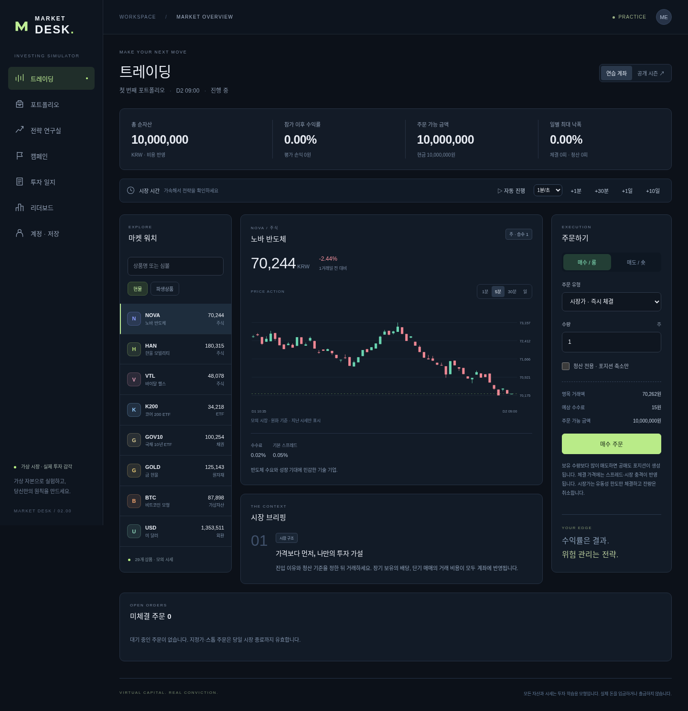

# MARKET DESK 2.0

가상 자본으로 주식·채권·외환·선물·옵션을 거래하는 투자 시뮬레이터입니다. 현실적인 규칙의 **합성 시세**를 사용하며 실제 돈이나 실시간 거래소 시세를 다루지 않습니다.

기본 화면을 새로운 투자 데스크로 재구축했습니다. 기존 1.15 게임은 `/classic`에서 열 수 있으며 `stockTradingGame` 저장은 그대로 유지됩니다. v2 연습은 별도 `marketdesk.v2` 저장을 사용합니다.

## 플레이

- **29개 상품**: 8개 현물 기초자산, 3개 선물, 18개 유럽형 옵션. 거래 단위·승수·비용·잔존 만기를 주문 화면에서 확인합니다.
- **다양한 투자 방식**: 현물/공매도, 시장가·지정가·스톱·청산 전용 주문, 부분 체결, 증거금과 강제 청산. 프로텍티브 풋·커버드 콜·불 콜 스프레드·현선물 헤지 및 2–4개 다리의 사용자 전략을 일괄 체결합니다.
- **6개 캠페인**: 1일 스캘핑, 5일 입문, 20일 헤지, 60일 중기 리밸런싱, 3년 장기 투자, 252일 자유 투자. 시간 가속, 수익률·분산·낙폭 과제와 완주 메달을 제공합니다.
- **기록과 회계**: 비용 반영 순자산, 일별 낙폭, 기간 수익률, 기준 지수 비교, 체결 일지, 배당락·배당 지급·차입 비용. 파일 내보내기/가져오기, 직전 백업, 손상된 원본 보존과 다중 탭 충돌 감지를 지원합니다.
- **공개 시즌**: 인증 계정, 서버 소유 시계·가격·계좌, 요청 중복 방지, 공통 시각의 성과 스냅샷. 기간·국가·지역·연령대별 순위를 공개 동의한 참가자끼리 비교합니다.
- **운영**: 관리자 클레임, 시즌 개설/종료, 신규 주문 중지, 비공개 신고/처리, 계정 제재/복구, 감사 로그, 접속하지 않은 계좌의 위험 정산.

공개 기능은 Firebase 프로젝트·Auth·App Check·Functions·Scheduler 설정과 배포가 필요합니다. 이 저장소에는 운영 프로젝트나 비밀키가 없습니다. 기본 실행은 로그인 없는 연습 모드입니다. 초기 공개 시즌 정원은 100명입니다.



## 실행

Node 24.19 이상 권장, Functions 런타임은 Node 22입니다.

```sh
npm ci
npm run dev
```

브라우저에서 `http://127.0.0.1:7777`을 엽니다. 빌드와 로컬 미리보기:

```sh
npm run build
npm run preview -- --host 127.0.0.1
```

첫 온라인 실행에서 앱 파일이 캐시된 뒤에는 같은 주소에서 연습과 기존 게임을 오프라인으로 열 수 있습니다. `index.html`을 직접 여는 방식은 지원하지 않습니다. 브라우저 데이터를 삭제하면 로컬 저장도 삭제되므로 필요한 기록은 파일로 보관하세요.

## 설계와 운영

- [가격·회계·증거금·성과의 정의와 한계](docs/desk/MARKET_MODEL.md)
- [에뮬레이터, 공개 서버 구성, 관리자 부여와 운영 대응](docs/desk/OPERATIONS.md)
- [.env.desk.example](.env.desk.example): 공개 웹 구성 예시
- 공통 엔진: `functions/src/desk/` (웹/서버가 같은 모델을 사용)
- 새 UI: `src/desk/`; 기존 UI: `src/App.jsx`

옵션은 유럽형 현금 정산이며 조기 행사, 실제 주문장, 세금·실시간 변동성 곡면은 지원하지 않습니다. 최대 낙폭은 일별 샘플링입니다. 국가·지역·연령대는 자기 신고 정보이며 세부 분류 순위는 5명 이상부터 표시합니다. 장기 캠페인의 파생상품은 시장 원점의 정해진 만기에 종료되고 자동 재상장되지 않습니다. 자세한 가정은 시장 모델 문서를 참고하세요.

## 검증

```sh
npm run lint
npm test -- --runInBand
npm ci --prefix functions
npm run build --prefix functions
node --test functions/tests/desk-core.test.cjs functions/tests/security-replay.test.cjs
npx playwright install chromium
npx playwright test --project=chromium --project="Mobile Chrome" --workers=1
npm run build
npm run test:detail
npm run test:offline
```

서버 통합 테스트는 로컬 Firebase Auth/Firestore/Functions 에뮬레이터를 필요로 합니다. 실행 방법과 데이터 초기화 범위는 운영 문서에 있습니다. CI는 회계·권한·중복 주문·동시성·순위 개인정보·신고·규칙 검증과 데스크톱/모바일 실제 사용자 흐름을 실행합니다. 테스트 통과는 미발견 결함이 없다는 보장이 아니며 운영 환경 App Check와 부하 검증은 배포 시 별도로 수행해야 합니다.

기존 게임의 상세 설명은 [재무](docs/detail-finance.md), [차트](docs/detail-charts.md), [저장](docs/detail-storage.md) 문서에 남아 있습니다.
